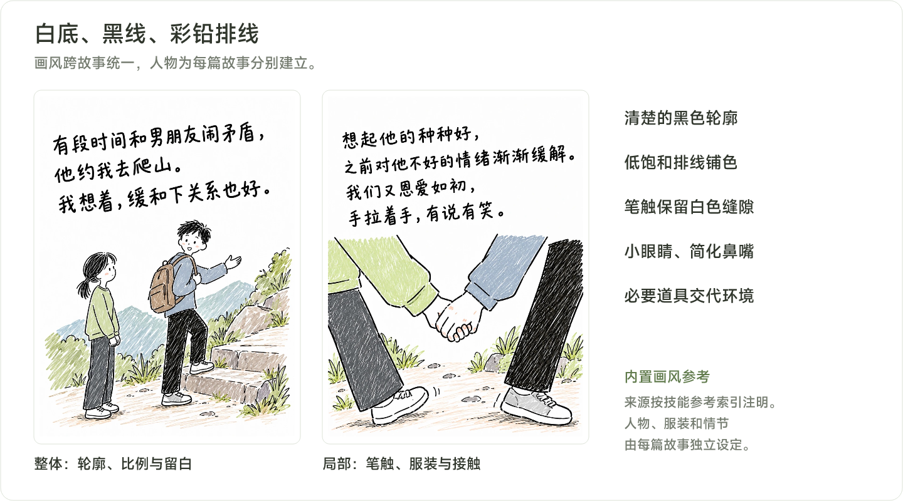
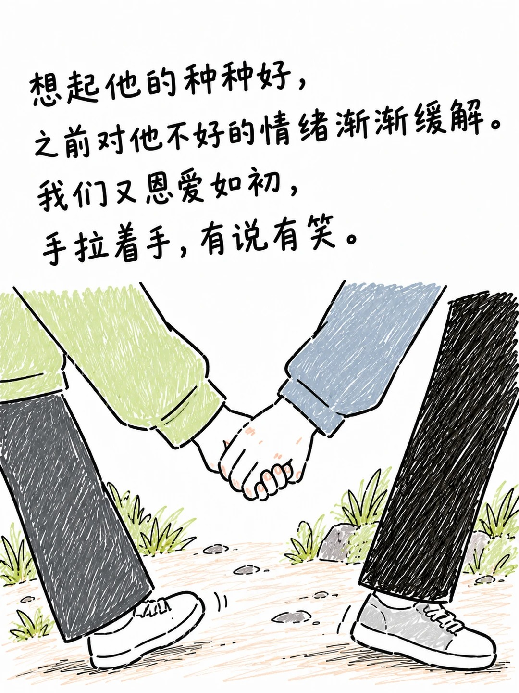
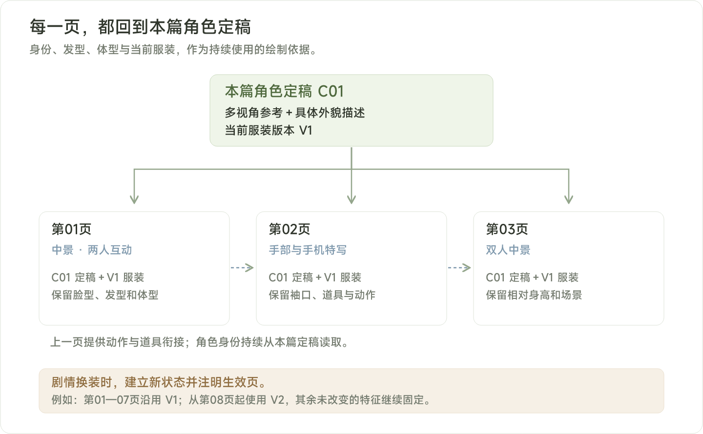
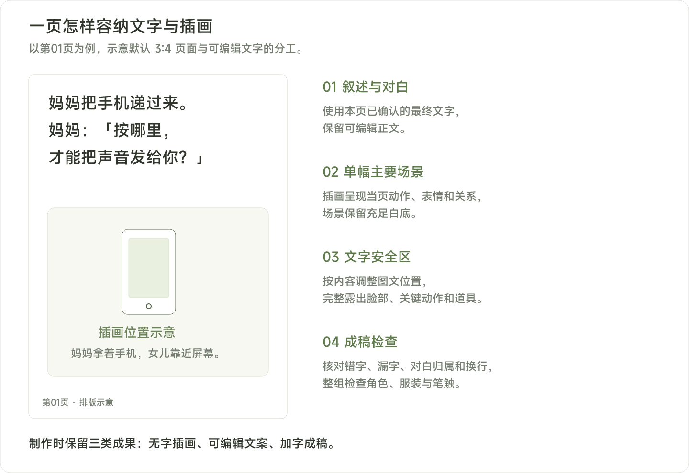

# 彩铅手绘故事漫画

<a id="contents"></a>
## 目录

1. [安装使用](#install)
2. [快速开始](#quick-start)
3. [画风与参考](#style)
4. [制作流程](#workflow)
5. [人物设定与一致性](#characters)
6. [四页分镜示例](#example)
7. [中文与页面排版](#layout)
8. [修改方式](#revision)
9. [交付内容](#outputs)
10. [与故事脚本配合](#collaboration)
11. [常见问题](#faq)
12. [技能文件结构](#structure)
13. [配图与来源](#credits)

---

**让一段生活故事，变成有统一画风和稳定人物的连续漫画。**

`colored-pencil-story-comic` 将故事、真实经历或已有文案，制作成白底留白、黑色手绘线稿、彩铅排线铺色的故事漫画。它可以整理分镜、设计人物、编写逐页提示词，也可以继续生成插画和中文排版成稿。

**白底黑线与彩铅 · 每篇独立设定人物 · 篇内角色保持一致 · 分阶段确认与制作**

[离线 HTML 说明](使用说明.html) · [技能规则](../SKILL.md)

<a id="install"></a>
## 1. 安装使用

通过 [Skills CLI](https://github.com/vercel-labs/skills) 安装（需要 Node.js 22.20 或更新版本）：

```bash
npx skills add hongshuai1991/colored-pencil-story-comic
```

按提示选择要安装到的 Agent。默认安装到当前项目；需要在多个项目使用时，可以选择全局安装：

```bash
npx skills add hongshuai1991/colored-pencil-story-comic -g
```

也可以下载本仓库，保留 `SKILL.md`、`agents/`、`references/` 和 `assets/` 的完整目录，再交给你使用的 Agent 安装。完成后，在聊天中点名 `colored-pencil-story-comic` 并提供故事素材即可。

<a id="quick-start"></a>
## 2. 快速开始

在已加载这个 skill 的聊天中，直接说明故事和本轮希望完成的范围：

```text
用 $colored-pencil-story-comic 制作一个彩铅手绘故事漫画。

故事：我教妈妈发语音。她学会后，坐在我旁边给我发了一句：
“下班早点回家，给你留着饭。”
我也回她：“收到，马上到。”

这是原创虚构，计划 4 页，3:4 竖版。
先给故事分镜和人物设定参考，确认后再试图。
```

你也可以只处理其中一部分：

| 当前需求 | 可以直接这样说 |
| --- | --- |
| 只整理文字 | “先把这段经历整理成逐页文案和分镜，本轮只做文字。” |
| 只设计人物 | “按这篇故事制作两位主角的设定参考，先完成角色部分。” |
| 已有确认稿 | “沿用这份已确认的 12 页文案和分镜，开始设计本篇人物。” |
| 先看画风效果 | “人物参考已定稿，先选正面、全身和互动场景做少量试图。” |
| 已确认人物与试图 | “按已确认的角色版本，继续完成授权范围内的剩余页面。” |

### 2.1 默认安排

默认采用 **3:4 竖版、一页一个主要画面，整篇最多 18 页**。页数随故事需要决定；你明确指定其他页数或尺寸时，以你的要求为准。已有确认稿时，生图阶段沿用确认的页数与文案。

涉及出图时，需要可用的生图工具，并能传入本篇角色参考。文字、分镜和人物档案可以先独立完成。

<a id="style"></a>
## 3. 画风与参考

画风在不同故事之间保持统一，人物根据每篇故事分别建立。



*画风图例采用 skill 内置参考；原图来源见后文。本文另附原创四页分镜示例，正式制作时确认本篇人物与试图。*

| 绘画部分 | 具体表现 |
| --- | --- |
| 背景与留白 | 白色背景，家具、植物和建筑只画叙事需要的部分 |
| 黑色轮廓 | 清楚的手绘线条，允许轻微抖动、断续和重复描线 |
| 彩铅上色 | 短线、斜线与交错排线铺色，保留笔触和白色缝隙 |
| 常用颜色 | 浅草绿、灰蓝、米黄、浅棕、炭灰，按故事需要调整 |
| 人物五官 | 圆润简化脸型、小黑点或小椭圆眼睛、简化鼻嘴、略大的头部 |
| 年龄与体型 | 成人、儿童、老人的身体比例和年龄感有区别 |
| 情绪表达 | 通过视线、眉嘴、肩膀、手势、站姿和人物间距表达 |

深色头发和裤子也保留排线纹理。悲伤、冷淡或愤怒的页面，表情应与剧情一致；画风以朴素、清楚的生活叙事为主。

### 3.1 内置画风参考怎么看

| 黑线、留白与全身比例 | 局部笔触与动作叙事 |
| :---: | :---: |
|  |  |

*参考图来自 skill 已有的本地画风素材，索引注明原图为「金漫漫」的小红书笔记。它们用于观察绘画特征，图中人物、服装与故事文字不作为新故事的默认设定。*

技能另外包含室内家庭与静物叙事参考；实际使用时，按当前场景选择相关图片。

<a id="workflow"></a>
## 4. 制作流程


| 阶段 | 会先看到什么 | 接下来怎样推进 |
| --- | --- | --- |
| ① 故事与分镜 | 逐页文案、出场人物、动作、构图与连续性信息 | 核对关键事实、人物关系、原话和结局 |
| ② 人物定稿 | 人物档案、多视角参考；多人故事可补身高对照 | 确认后记录为本篇角色定稿 |
| ③ 少量试图 | 脸部、全身服装，以及故事里真实存在的互动动作 | 确认画风、人物和动作是否合适 |
| ④ 连续制作 | 按分镜生成插画，沿用角色定稿与当前服装版本 | 在已授权范围内继续完成页面 |
| ⑤ 整组检查 | 并排查看全部页面，检查人物、配色、笔触与衔接 | 修正问题页，再交付整组 |

**需要你确认的关键节点是人物和试图。** 已有本篇定稿角色时直接沿用；确认人物与试图后，按你授权的范围继续制作，通常无需每页重复确认。

<a id="characters"></a>
## 5. 人物设定与一致性

核心依据是 **本篇人物定稿＋固定外貌特征＋当前服装版本**。角色编号如 `C01`、`C02` 方便识别，同时还需要具体描述和参考图。



### 5.1 一份人物档案包含什么

| 档案字段 | 记录内容 |
| --- | --- |
| 身份与年龄感 | 故事关系、年龄阶段 |
| 脸部 | 脸型、眼睛形状与间距、眉形、鼻嘴 |
| 发型 | 发色、分缝、刘海、长度、扎发位置与发饰 |
| 身体 | 体型、肩宽、头身比例、与其他角色的相对身高 |
| 上装 | 颜色、领口、袖口、衣长、开合方式和明显细节 |
| 下装与鞋 | 裤裙版型、长度、颜色和鞋型 |
| 固定配件 | 眼镜、包、首饰等 |

正式连续出图前，会先制作主要角色的**正面、四分之三侧面、侧面和背面**参考，检查各个视角是否属于同一人物。多人互动时，补充同框身高对照。

### 5.2 固定什么，允许变化什么

| 类型 | 处理方式 |
| --- | --- |
| 默认固定 | 基础脸部、发型结构、体型、相对身高，以及当前服装的颜色和识别细节 |
| 自然变化 | 表情、姿态、视角、透视、衣褶、受动作影响的发丝和合理遮挡 |
| 剧情变化 | 换装、剪发、年龄变化等，建立新状态，并记录生效页码 |

分缝、发饰和不对称衣服细节遵循人物自身左右。手机、背包等道具的拿放与转交，也需要符合前后动作。

### 5.3 一页出图时，实际带上哪些信息

每页同时提供统一画风、本页人物定稿及固定特征、当前服装、分镜动作与构图，以及必要的场景和道具状态。参考图会区分为画风参考、角色参考、服装参考或场景参考。

上一页可以辅助衔接，每页仍以本篇角色定稿为身份依据。新故事通常另建人物；你明确要求复用其他故事人物时，再按要求沿用。

<a id="example"></a>
## 6. 四页分镜示例

**原创示例：教妈妈发语音。** 以下文字和人物仅用于解释工作方式，正式制作时仍需确认本篇分镜、人物和试图。

### 6.1 两位角色的示意档案

| 编号 | 身份 | 主要识别特征 | 当前服装 |
| --- | --- | --- | --- |
| C01 | 女儿，约 28 岁 | 侧分黑色齐下巴短发，偏窄圆脸，身形较高较瘦 | 草绿色圆领开衫、米白内搭、炭灰直筒宽裤、白鞋 |
| C02 | 妈妈，约 60 岁 | 灰色短卷发，细圆框眼镜，脸形较圆，身形较矮较丰满 | 灰蓝无领背心、米黄长袖、浅棕长裤、深灰平底鞋 |

这是一份简化示例。实际人物档案还会补齐五官间距、分缝方向、领口袖口和固定配件等细节，并配合定稿参考使用。

### 6.2 四页怎么安排

| 页码 | 最终叙述与对白 | 画面与构图 | 连续性 |
| --- | --- | --- | --- |
| 01 | 妈妈把手机递过来。妈妈：「按哪里，才能把声音发给你？」 | 客厅沙发，中景；妈妈拿着手机看向女儿，女儿靠近屏幕 | C01、C02；同一套居家服；妈妈的黑色手机 |
| 02 | 我指着那个按键。 我：「一直按住，说完再松手。」 | 手机与双手特写；女儿指向按键，妈妈握稳手机 | 保留两人的袖口；手机仍在妈妈手中 |
| 03 | 她认真说：「下班早点回家，给你留着饭。」我就坐在她旁边，手机响了。 | 双人中景；妈妈对手机说话，女儿低头看自己的另一部手机 | 同一张沙发；明确区分两部手机 |
| 04 | 我也按住语音键。 我：「收到，马上到。」 她看了我一眼，忍不住笑了。 | 双人近景；女儿举起自己的手机回复，妈妈转头看她 | 人物与服装不变；女儿持自己的手机 |

每页分镜至少包含：**页码、最终叙述文字、出场人物、画面、构图和连续性**。真实经历保留关键事实、人物关系和你的判断；需要补充对白或情节时，作为创作建议提出。

### 6.3 从分镜到逐页提示词

下面是“提示词组织示例”，帮助理解每页如何携带身份与连续性信息。实际出图时，需要同时附上本篇角色定稿参考。

```text
第 02 页：手机与双手特写

画风：白底留白，黑色自然手绘轮廓，低饱和彩铅排线铺色。
角色：C01、C02，身份依据本篇已确认的定稿参考。
服装：沿用 C01-V1、C02-V1；保持草绿袖口与米黄袖口。
动作：C02 双手握稳自己的黑色手机，C01 用食指示范语音按键。
构图：手部和手机近景，动作接触清楚，屏幕信息简化。
衔接：手机仍由 C02 持有，C01 的另一部手机尚未进入这个特写。
文字：先保留可编辑文案，排版阶段加入本页已确认的叙述与对白。
```

<a id="layout"></a>
## 7. 中文与页面排版

默认采用大字叙述配合一个主要场景，文字与画面的位置按内容调整。正文使用清晰的黑色手写感字体、宽松行距与充足边距，避免遮挡脸部、关键动作和道具。



优先先生成插画，再用稳定方式加入中文。制作时保留**无字插画、可编辑文案和加字成稿**；排版沿用已确认文案，文字过多时优先调整分页。

<a id="revision"></a>
## 8. 修改方式

| 你想调整什么 | 可以直接复制的请求 |
| --- | --- |
| 保留已确认的故事 | “按确认稿制作，保留人物关系、关键原话和最后一页的结局。” |
| 人物长相变了 | “第 6 页的脸型和发型偏离定稿，请按 C01 的定稿参考修正这一页。” |
| 剧情发生换装 | “从第 8 页起，C02 换成灰色外套，建立 V2 服装状态，前面的页面沿用 V1。” |
| 手部或接触关系有误 | “第 4 页握手的手指和袖口接触不清，请先修正手部，再检查受影响区域。” |
| 只修改文字 | “沿用无字插画，只替换这一句对白，保留其余文案。” |
| 需要更换新故事人物 | “这篇重新建立角色，沿用彩铅画风，人物根据新故事设定。” |
| 希望保留悬疑结尾 | “最后的异常画面按原稿保留，关键线索到指定页再出现。” |

问题优先修正在相关部位或页面，随后核对受影响区域。整组完成后，还会并排检查脸部、头身比例、配色和笔触是否逐渐变化。

<a id="outputs"></a>
## 9. 交付内容

交付取决于你本轮授权的范围，可以停在文字、人物或试图，也可以继续完成整篇。

| 工作范围 | 交付内容 |
| --- | --- |
| 文字阶段 | 故事分页、最终文案、出场人物、动作、构图与连续性 |
| 人物阶段 | 人物档案、各视角参考与本篇角色定稿 |
| 试图阶段 | 代表性页面或动作的试图，以及需要调整的问题 |
| 连续制作 | 逐页提示词或生成配图、角色与服装版本记录 |
| 整篇完成 | 无字插画、可编辑正文与对白、加字成稿，以及仍需处理的问题 |

技能约定保留这些成果，具体文件名和保存目录可按你的要求安排。未通过一致性或结构检查的页面，会标记为待修正；生成结果需要经过检查与必要的修正。

<a id="collaboration"></a>
## 10. 与故事脚本配合

「故事漫画脚本」可以先整理逐页成稿；本 skill 可以接着完成角色设定、试图、连续配图和排版。

```text
以下是已经确认的漫画脚本。
请用 $colored-pencil-story-comic 继续制作。
保留现有页数、原话和结局，先建立本篇人物档案与设定参考。
人物确认后，选择脸部、全身和互动场景做少量试图。
```

<a id="faq"></a>
## 11. 常见问题

### 11.1 每篇故事都用同一批人物吗？

画风统一，人物按故事分别建立。你明确要求沿用其他故事的人物时，再复用相关角色。

### 11.2 角色编号能保证人物一致吗？

编号用于识别。实际还需要具体外貌描述、定稿参考图和当前服装版本，每页都以本篇定稿为依据。

### 11.3 确认人物以后，每一页都要重新确认吗？

确认人物与少量试图后，会按你授权的范围继续制作。已有本篇定稿角色时直接沿用。

### 11.4 可以只做人物或只给提示词吗？

可以。开头说明本轮范围即可；只整理文字时交付文字，只做人物时完成角色阶段。

### 11.5 真实经历或悬疑故事会被改写吗？

关键事实、人物关系、原话和明确判断会保留。悬疑故事按你指定的揭示顺序和开放结尾制作；补充剧情或对白时，作为创作建议提出。

### 11.6 工具不能传角色参考图怎么办？

会说明当前工具的限制，先交付分镜和提示词。连续人物一致性需要以可用的角色参考机制配合检查。

### 11.7 可以保证每张图一次成功吗？

人物一致性和动作结构是验收要求，生成后仍需检查与修正。反复修正仍有问题时，会说明具体偏差及可调整的动作或构图。

<a id="structure"></a>
## 12. 技能文件结构

```text
colored-pencil-story-comic/
├── SKILL.md                       工作规则与分阶段流程
├── agents/openai.yaml             显示名称和简短描述
├── references/
│   └── style-reference-index.md    画风参考索引与使用方式
└── assets/style-references/
    ├── 01-outdoor-pair.jpg          户外双人参考
    ├── 02-family-interior.jpg       室内家庭参考
    ├── 03-hand-detail.jpg           牵手特写参考
    └── 04-still-life.jpg            静物叙事参考
```

这份 skill 主要组织故事、人物与生图工作的执行规则。实际图片生成与中文排版由当前可用工具完成。

<a id="credits"></a>
## 13. 配图与来源

画风参考图来自技能内置素材，原作者为「金漫漫」。人物、服装和原图故事只用于说明参考特征；新故事按本篇素材建立角色。

本文的四页故事为原创虚构，画风总览、制作流程、人物一致性和页面排版图为本项目整理或绘制。示意人物与页面用于讲解，正式制作仍按人物定稿、少量试图和连续制作流程推进。

详细出处见[画风参考索引](../references/style-reference-index.md)及[素材来源](../ATTRIBUTION.md)。

文档更新：2026 年 11 月 2 日。
